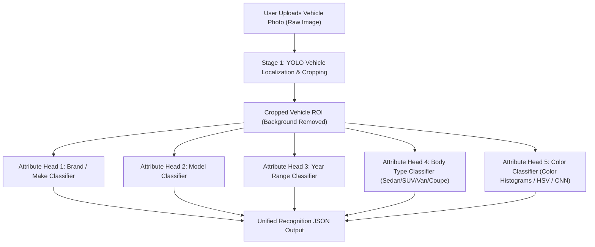

# AutoVision - Agent Guidelines & Project Architecture

Welcome to **AutoVision**, our final year graduation project (Bitirme Projesi). This document serves as the primary instructions and architecture repository for AI agents assisting on this codebase.

---

## 1. Project Vision & Final Product Objective

> [!IMPORTANT]
> **Ultimate System Goal**:  
> An end-to-end Computer Vision system where a user uploads a single arbitrary vehicle photograph, and the model outputs full multi-attribute vehicle recognition:
> 1. **Brand (Make)**: e.g., *Toyota, Ford, Honda, Chevrolet, Nissan, Volkswagen, Dodge*
> 2. **Model**: e.g., *Camry, Mustang, Accord, Explorer, Altima, Jetta, Grand Caravan*
> 3. **Year / Generation**: e.g., *2002-2003, 2005-2006, 2000-2001, 2004-2005*
> 4. **Type (Body Category)**: e.g., *Sedan, SUV, Minivan, Coupe/Sports, Hatchback, Truck*
> 5. **Color**: e.g., *White, Black, Silver/Gray, Red, Blue, etc.*

---

## 2. End-to-End Pipeline Architecture

---

## 3. Project Roadmap & Development Phases

### Phase 1: Feature Exploration, Clustering & Attribute Decomposition (CURRENT)
- **Attribute Decomposition**:
  - Parse ground truth strings `<brand>_<model>_<year>` into structured columns: `brand`, `model`, `year`, `body_type`.
- **Color Extraction Module**:
  - Implement vehicle color detection from `train_images/` using central ROI color histograms / HSV K-Means clustering.
- **Representation Analysis**:
  - Feature distributions, PCA variance, t-SNE / Spectral manifold learning.
  - Understand which vehicle attributes (body type vs. color vs. make/model) are captured by unsupervised representations.

### Phase 2: YOLO Detection & Bounding Box Pipeline (UPCOMING)
- **Object Detection**: Train YOLO (YOLOv8 / YOLOv11) to detect vehicles in raw images and crop the vehicle bounding box, eliminating noisy background clutter.
- **Dataset Generation**: Automated conversion of annotations into standard YOLO format (`images/`, `labels/`, `data.yaml`).

### Phase 3: Multi-Task Classification & Unified Inference Engine
- **Multi-Head Attribute Classifier**: Train backbones (e.g. EfficientNet, ResNet, or YOLO classification head) to simultaneously predict `brand`, `model`, `year`, and `type`.
- **Color Recognition Integration**: Combine CNN features with HSV/color analysis.
- **Inference CLI & Web UI**:
  - An interactive demo (Streamlit / Gradio / FastAPI) where the user drops an image and sees:
    - Bounding box overlay
    - Attributes card: **Brand**, **Model**, **Year**, **Body Type**, **Color**, with prediction confidence scores.

---

## 4. Dataset Specification

Current workspace files:
- `train_data.csv`: CSV with no header (`<class_name>,<image_filename>`).
  - Class names follow format `<brand>_<model>_<year>` (e.g. `toyota_camry_2002-2003`).
- `train_features.csv`: Headerless matrix of 512-dim CNN embeddings (5,000 samples).
- `train_images/`: Raw images organized in subfolders by class name.
- **Data Scaling Note**: More images and features will be added in upcoming project sprints. Keep code modular and dynamic.

---

## 5. Environment & Execution Guidelines for Agents

- **Python Virtual Environment**: `.venv` at project root (Python 3.14).
  - Executable: `.\.venv\Scripts\python.exe`
  - Activation: `.\.venv\Scripts\Activate.ps1`
- **Jupyter Kernel**: `Python 3.14 (bitirme)` (`bitirme`).
- **Dependencies**: All packages tracked in `requirements.txt`.
- **Git Hygiene**:
  - Commit messages must follow conventional commits: `feat:`, `fix:`, `docs:`, `refactor:`, `chore:`.
  - Raw images in `train_images/` are kept local / ignored to prevent repo bloat.
  - All reusable modules live under `src/`, notebooks under root or `notebooks/`, and figures under `reports/figures/`.
