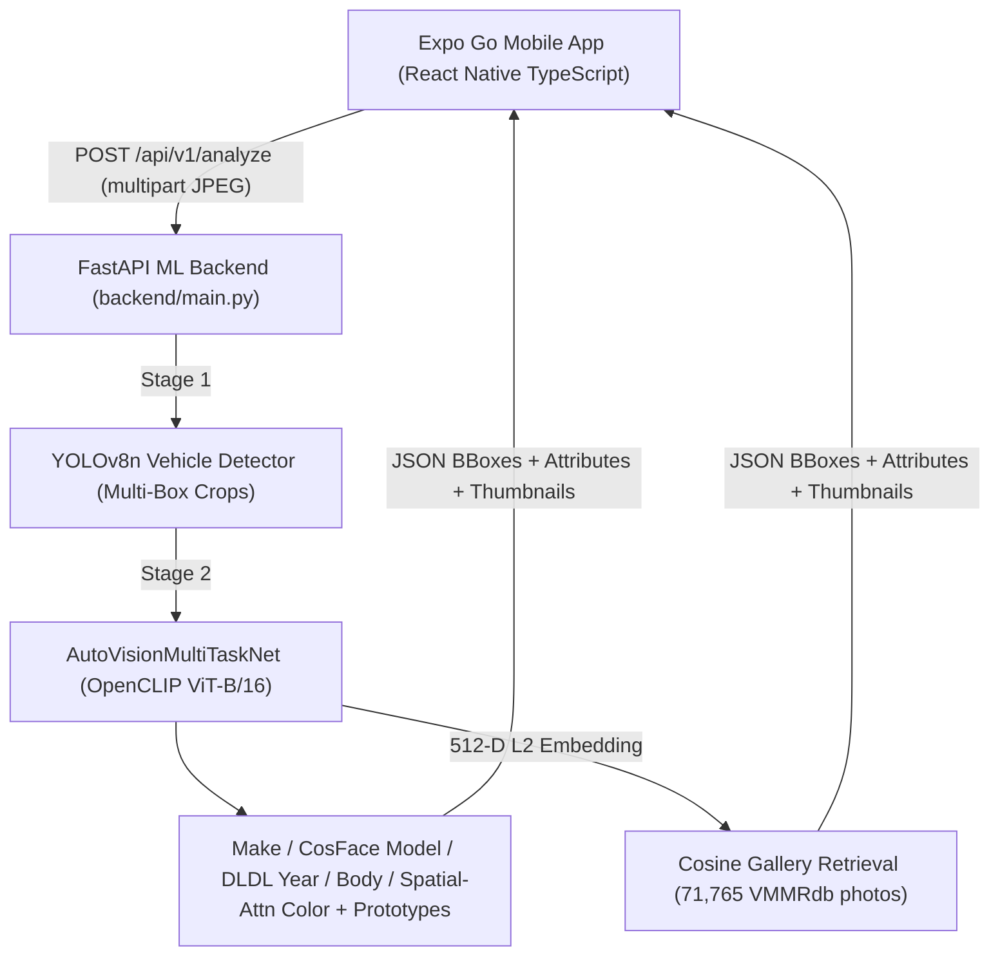

# AutoVision: Intelligent Multi-Attribute Vehicle Recognition System

**AutoVision** is a graduation thesis project (`Bitirme Projesi`) implementing end-to-end vehicle localization, 5-attribute multi-task classification, few-shot prototype matching, and visual similarity retrieval across a FastAPI ML backend and an Expo Go mobile client.

---

## Project Objective

Given a single arbitrary street photograph containing one or more vehicles, AutoVision predicts:

1. **Make** (22 trained manufacturers)
2. **Model** (225 CosFace head classes + 342 nearest-prototype / few-shot classes)
3. **Model Year** (DLDL distribution learning + uncertainty interval `[range_low, range_high]` and `±std`)
4. **Body Type** (8 macro categories: Sedan, SUV, Pickup, Minivan, Coupe, Hatchback, Wagon, Convertible)
5. **Exterior Color** (15 fine VCoR classes, 12 automotive groups, and calibrated RGB hex swatches)
6. **Similar Gallery Matches** (Cosine similarity search across 71,765 indexed reference images)

---

## System Architecture



---

## Verified Benchmark Highlights (Stage 5 Holdout Evaluation)

| Task | Metric | Baseline (Frozen OpenCLIP) | Fine-Tuned AutoVision | Gain |
| :--- | :--- | ---: | ---: | ---: |
| **Make** | Top-1 Accuracy | 91.91% | **98.27%** | +6.36% |
| **Model** | CosFace Top-1 / Top-5 | 90.52% / 98.65% | **96.38% / 98.92%** | +5.86% |
| **Model** | Nearest Prototype Top-1 | 64.09% | **96.16%** | +32.07% |
| **Model** | Cosine kNN (`k=5`) Top-1 | 90.78% | **97.15%** | +6.37% |
| **Few-Shot** | 1-Shot Prototype Top-1 / Top-5 | 35.07% / 50.69% | **39.06% / 71.35%** | +20.66% (Top-5) |
| **Body Type** | Top-1 / Macro-F1 | 92.35% / 87.60% | **97.69% / 95.77%** | +5.34% |
| **Year (DLDL)** | MAE / Within ±2 Years | 2.03 yr / 58.72% | **1.05 yr / 87.56%** | -0.97 yr |
| **Color (VCoR)** | 15-Class Top-1 / 12-Group Top-1 | 28.08% / 29.63% | **86.76% / 90.81%** | +58.68% / +61.18% |

---

## Repository Structure

```text
AutoVision/
├── backend/                     # Stage 6A: Modular FastAPI ML inference service
│   ├── main.py                  # FastAPI app factory, lifespan, CORS, error handlers (`app`)
│   ├── config.py                # Pydantic settings & artifact paths
│   ├── schemas.py               # Strict Pydantic v2 API contracts
│   ├── security.py              # Upload validation & path traversal guards
│   ├── ml/                      # detector.py, classifier.py, retriever.py, pipeline.py
│   └── routers/                 # health.py, analyze.py, gallery.py
├── mobile/                      # Stage 6B: Expo Go React Native TypeScript client
│   ├── App.tsx                  # Root container, Inter font loader, ErrorBoundary, persistent tab shell
│   ├── app.json                 # Dark OLED theme, permissions & local-network cleartext HTTP config
│   ├── package.json
│   ├── src/
│   │   ├── components/          # VehiclePhotoFrame, VehicleCard, SimilarCarsStrip, ConnectionSheet, BottomTabBar
│   │   ├── screens/             # ScanScreen, GarageScreen
│   │   ├── services/            # apiClient.ts, storage.ts (AsyncStorage)
│   │   ├── theme/tokens.ts      # True-black flat design tokens (#000000 / #111111 / #C6F24E + Inter)
│   │   ├── types/api.ts         # 1-to-1 mirror of backend/schemas.py
│   │   └── utils/formatters.ts  # Pure formatting & letterbox geometry helpers
│   └── tests/formatters.test.mjs
├── src/                         # Data prep, OpenCLIP extraction & Stage 5 evaluation scripts
├── kaggle/                      # Kaggle 89.5k training & extraction scripts
├── models/                      # Local trained weights & indexes (gitignored)
├── reports/                     # Stage evaluation reports, CSVs, figures & thesis_log.md
├── tests/                       # Backend, pipeline & evaluation Python unit tests
├── requirements.txt
└── README.md
```

---

## Quick Start (2 Terminals over Wi-Fi)

### Terminal 1 — FastAPI ML Backend (Windows)

```powershell
cd D:\Projects\bitirme\AutoVision
.\.venv\Scripts\Activate.ps1
uvicorn backend.main:app --host 0.0.0.0 --port 8000
```

Verify local readiness: open `http://192.168.1.13:8000/docs` or `GET /health`. Ensure TCP port `8000` is allowed on Private Wi-Fi in Windows Defender Firewall so your phone can reach the backend.

### Terminal 2 — Expo Go Mobile Client

```powershell
cd D:\Projects\bitirme\AutoVision\mobile
npx expo start
```

Scan the QR code in **Expo Go** (iOS/Android on the same Wi-Fi network) or press `w` for Web preview. If a network address change is needed (default `http://192.168.1.13:8000`), tap **Change address** on the connection prompt or long-press the **AutoVision** title.

---

## Automated Verification Suites

- **Backend & ML tests (`unittest`)**:
  ```powershell
  python -m unittest discover -s tests -p "test_*.py" -v
  ```
- **Mobile TypeScript check & formatter unit tests**:
  ```powershell
  cd D:\Projects\bitirme\AutoVision\mobile
  npx tsc --noEmit
  node --test tests/formatters.test.mjs
  ```

---

## Project Roadmap

- [x] **Stage 1–2**: Baseline feature extraction (`OpenCLIP ViT-B/16` & `DINOv2`), spectral manifold clustering, and taxonomy cleanup.
- [x] **Stage 3A–3B**: 5-attribute manifest preparation, VCoR 15/12 color taxonomy, and `AutoVisionMultiTaskNet` architecture.
- [x] **Stage 4**: Multi-Task Fine-Tuning on Kaggle GPU (`89,535` VMMRdb + `10,373` VCoR images).
- [x] **Stage 5**: Before/After evaluation report & 7 diagnostic figures (`reports/stage5_evaluation_report.md`).
- [x] **Stage 6A**: Modular FastAPI ML backend (`backend/`) with 34 automated unit/API tests.
- [x] **Stage 6B**: Expo Go React Native TypeScript mobile application (`mobile/`) with consumer-focused `True-black flat` UI (`Scan`, `Garage`), interactive vehicle selector, car card, and visual gallery matches.
