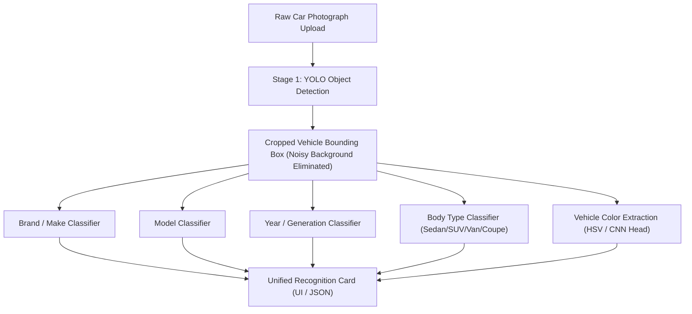

# AutoVision: Intelligent Multi-Attribute Vehicle Recognition System

**AutoVision** is our final year graduation project (Bitirme Projesi) focused on comprehensive vehicle recognition from photographs using deep computer vision.

---

## 🎯 Project Objective

The ultimate goal of AutoVision is to allow a user to **upload a single arbitrary car photograph** and receive full multi-attribute vehicle identification:

1. **Brand (Make)**: e.g. *Toyota, Ford, Honda, Chevrolet, Nissan, Volkswagen, Dodge*
2. **Model**: e.g. *Camry, Mustang, Accord, Explorer, Altima, Jetta, Grand Caravan*
3. **Year / Generation**: e.g. *2002-2003, 2005-2006, 2000-2001, 2004-2005*
4. **Type (Body Category)**: e.g. *Sedan, SUV, Minivan, Coupe/Sports, Hatchback*
5. **Color**: e.g. *White, Black, Silver, Red, Blue, etc.*

---

## 🏗️ System Architecture



---

## 📁 Repository Structure

```
AutoVision/
│
├── .venv/                   # Python virtual environment (Python 3.14)
├── train_images/            # Raw vehicle images (organized by class, local/ignored in Git)
├── train_data.csv           # Image-to-label mapping (<class_name>, <filename>)
├── train_features.csv       # Pre-extracted 512-dim CNN embeddings (5,000 samples)
├── AGENTS.md                # Agent instructions and development guidelines
├── requirements.txt         # Project dependencies
├── notebook.ipynb           # Interactive exploration and clustering notebook
├── src/
│   ├── clustering_pipeline.py    # Baseline clustering and PCA profiling
│   ├── optimized_clustering.py   # Spectral manifold learning & optimization suite
│   ├── cluster_inspection.py     # Prototype extraction and visual confusion analysis
│   └── macro_and_visual_analysis.py # Macro-category body classification and prototypes
├── reports/
│   ├── optimization_benchmark_metrics.csv # Full metric evaluation table
│   └── figures/                  # High-resolution benchmark plots and montages
└── README.md                # Project documentation
```

---

## 🚀 Setup & Execution

### 1. Activate Virtual Environment

**Windows PowerShell**:
```powershell
.\.venv\Scripts\Activate.ps1
```

**Windows Command Prompt (CMD)**:
```cmd
.\.venv\Scripts\activate.bat
```

### 2. Run Optimization Suite
To execute the clustering benchmarks and export figures:
```powershell
python src/optimized_clustering.py
```

### 3. Interactive Jupyter Notebook
```powershell
jupyter notebook
```
Or open [notebook.ipynb](notebook.ipynb) directly in Antigravity IDE / VS Code.

---

## 🔄 Project Roadmap

- [x] **Phase 1: Feature Representation & Clustering Analysis**
  - Evaluated baseline vs. manifold clustering (Spectral Embedding achieved **0.4935 Silhouette** and **0.1486 ARI**).
  - Decomposed ground truth into multi-attribute structure (`brand`, `model`, `year`, `body_type`).
- [ ] **Phase 2: YOLO Vehicle Detection & Cropping**
  - Train YOLO (e.g. YOLOv8/v11) to localize vehicles in real-world scenes.
  - Automatically crop vehicle bounding box to eliminate background noise.
- [ ] **Phase 3: Multi-Task Attribute Classification & Color Head**
  - Train multi-head classifier for Brand, Model, Year, Body Type, and Color.
  - Build interactive demo UI (upload photo -> instant attribute card).
