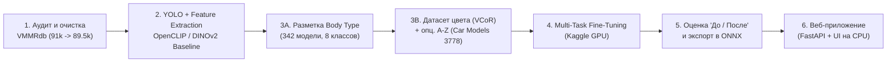
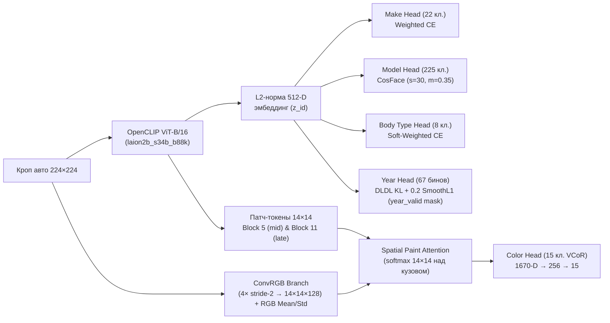
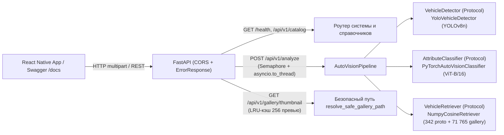

# AutoVision — Инженерный журнал дипломного проекта (Bitirme Log)

Живой структурированный документ фиксации всех этапов, инженерных решений, арифметики данных, таблиц метрик и визуальных артефактов для пояснительной записки и защиты диплома.

---

## Раздел 0. Постановка задачи и общая архитектура системы

**Цель проекта `AutoVision`:** по одной произвольной уличной фотографии автомобиля автоматически локализовать транспортное средство в кадре и определить **5 целевых атрибутов** + визуально похожие аналоги:

1. **Марка (`Make`)** — производитель автомобиля.
2. **Модель (`Model`)** — каноническая модель.
3. **Год выпуска (`Year`)** — оценка модельного года / поколения.
4. **Тип кузова (`Body Type`)** — 8 классов (`Sedan`, `SUV`, `Pickup`, `Minivan`, `Coupe`, `Hatchback`, `Wagon`, `Convertible`).
5. **Цвет кузова (`Color`)** — классификация цвета кузова с устойчивостью к освещению и теням.

### Сквозной 7-этапный маршрут разработки

---

## Раздел 1. Этап 1 — Аудит, нормализация таксономии и дедупликация данных

**Исходные данные:** `D:\Projects\bitirme\data` (обработка строго *read-only* через [prepare_local_data.py](file:///D:/Projects/bitirme/AutoVision/src/prepare_local_data.py)).
- Объём: **91 678 изображений** (`90 451` `.jpg`, `1 227` `.png`), **3.82 ГБ**, **3 356 папок** формата `<make>_<model>_<year>`, диапазон лет `1900–2016`.
- Покрытие: подмножество VMMRdb (марки с `Mazda` по `Willys`), реальные уличные и парковочные снимки.

### 1.1. Выявленные проблемы сырых данных и решения

1. **Избыточная дробность комплектаций и синонимов (`478 → 342` канонических класса, `35 → 34` марок):**
   - Комплектации одного кузова объединены в единый класс (`camry_le/se/xle → camry`, `corolla_ce/dx/le/s/wagon → corolla`).
   - Исправлены опечатки и дубли (`solara_convertable → solara`, `bug / newbeetle / superbeetle → beetle`, `rabbit → golf`, `cx90 → xc90`, `saturn/view → vue`, `porsche/930,997 → 911`).
   - 100 дробных индексов Mercedes-Benz свёрнуты в серии (`c220..c350, c55 → c-class`, `e300..e63 → e-class`, `ml320..ml550 → m-class` и т.д.).
   - Информативные суффиксы кузова перед объединением сохранены в поле `body_hint` (`_wagon` → `Wagon`, `_convertible`/`_convertable` → `Convertible`).
2. **Фильтрация нецелевого шума и битых файлов (`2 143` фото исключены, `2.34%`):**

| Категория очистки | Количество фото | Доля |
| :--- | ---: | ---: |
| Всего исходных файлов | 91 678 | 100.00% |
| Не легковые (`non_car`: мотоцикл `boulevard`, `slingshot`, `vnl`, `fuso`, `flatbed`) | 50 | 0.05% |
| Размытые сводные метки (`ambiguous_label`: `toyota_scion`, `nissan_truck`, `toyota_van`, `ht350`) | 135 | 0.15% |
| Битые файлы (`is_corrupt`) | 0 | 0.00% |
| Слишком мелкие (`< 80 px`, `is_tiny`) | 6 | 0.01% |
| Дубликаты внутри класса (64-bit `dHash`) | 1 806 | 1.97% |
| Коллизии `dHash` между разными классами (исключены все копии) | 146 | 0.16% |
| **Итого чистых уникальных фото (`is_clean`)** | **89 535** | **97.66%** |

3. **Санитарная проверка годов выпуска (`year_valid`):**
   - Обнаружено **88** чистых фото с ошибочными годами (`porsche_911_1900`, `toyota_mr2_1900`, `toyota_supra_1900`, `volkswagen_golf_1900`, `volkswagen_beetle_1908`, `toyota_camry_1938` и др.).
   - Решение: фото **остаются** в базе для обучения/теста марки и модели, но помечаются `year_valid=False` и маскируются при обучении и оценке регрессии года.
4. **Честное разбиение без утечки данных (Data Leakage Free Split):**
   - Порог основных классов: **≥ 15 чистых фото** → **225 классов** (`train / val / test` = `80% / 10% / 10%`), классы с `1..14` фото (**117 классов**) выделены в `few_shot`.
   - Итого: `train = 71 072` (`77.52%`), `val = 8 885` (`9.69%`), `test = 8 885` (`9.69%`), `few_shot = 693` (`0.76%`), `excluded = 2 143` (`2.34%`).
   - Инвариант подтверждён тестами ([test_prepare_local_data.py](file:///D:/Projects/bitirme/AutoVision/tests/test_prepare_local_data.py)): пересечение `dHash` между `train / val / test / few_shot` равно **0**.
5. **Обоснование этапа детекции YOLO (пробный прогон `500` чистых фото через `YOLOv8n`):**
   - `496` (`99.2%`) — крупный экстерьер (`bbox > 8%` площади кадра), `4` (`0.8%`) — авто не найдено.
   - На **`143` из `500` фото (`28.6%`)** в кадре присутствует **2 и более крупных автомобиля**, что научно обосновывает обязательный кроп главного объекта перед классификатором.
6. **Упаковка под Kaggle ([pack_kaggle_dataset.py](file:///D:/Projects/bitirme/AutoVision/src/pack_kaggle_dataset.py)):**
   - Выявлено **277** имён файлов со спецсимволами (`+`: 224, `,`: 41, `$`: 8, `'`: 6, `)`: 4, `(`: 4) и пробелами.
   - Все 89 535 чистых фото перепакованы в безопасную ASCII-структуру `images/000/000000.jpg` (ZIP `3.75 ГБ`, `0` небезопасных символов) с сохранением исходных `rel_path` в манифесте.

- Подробный отчёт этапа: [local_data_audit.md](file:///D:/Projects/bitirme/AutoVision/reports/local_data_audit.md).

---

## Раздел 2. Этап 2 — Локализация `YOLOv8n`, извлечение признаков и Baseline

**Реализация:** [extract_vmmrdb_full_kaggle.py](file:///D:/Projects/bitirme/AutoVision/kaggle/extract_vmmrdb_full_kaggle.py) (Kaggle GPU CUDA) и [evaluate_features_baseline.py](file:///D:/Projects/bitirme/AutoVision/src/evaluate_features_baseline.py) (локальная оценка).

### 2.1. Конвейер извлечения признаков (на всех `89 535` чистых фото)

1. **Детекция `YOLOv8n` (`classes=[car, bus, truck]`, `conf=0.25`):**
   - Выбор самого крупного бокса (`area_ratio > 0.08`) с отступом `+5%` по краям (чтобы не обрезать фары и бамперы); при отсутствии крупного бокса — запасной центральный кроп 85%.
   - Успешная детекция на полном датасете (`1 585.55 сек`): **`98.83%` (`0.9883`)**.
2. **Предобученные энкодеры + Flip TTA (`horizontal_flip` + L2-нормализация, хранение `float16`):**
   - **`OpenCLIP ViT-B/16`** (`laion2b_s34b_b88k`, `512-D`, прямой ресайз `224×224` без center-crop): `566.57 сек` (`158.0 img/s`).
   - **`DINOv2 ViT-B/14`** (`facebookresearch/dinov2`, `768-D`): `771.54 сек` (`116.0 img/s`).
   - **`Fusion (OpenCLIP + DINOv2)`** (`1280-D`): независимая L2-нормализация блоков, конкатенация и финальная L2-нормализация.

### 2.2. Результаты Baseline на замороженных признаках (`test = 8 885` фото, `225` моделей / `34` марки)

| Признаки | Dim | Задача | Метод | N eval | Top-1 | Top-5 | Macro-F1 | MAE (лет) | Within ±2 г. |
| :--- | ---: | :--- | :--- | ---: | ---: | ---: | ---: | ---: | ---: |
| `openclip_vitb16` | 512 | Make | Nearest Prototype | 8 885 | 60.57% | 90.10% | 48.92% | — | — |
| `openclip_vitb16` | 512 | Make | Cosine kNN (k=5) | 8 885 | **96.48%** | 99.32% | **93.86%** | — | — |
| `openclip_vitb16` | 512 | Make | Linear Probe | 8 885 | 91.91% | 99.40% | 88.35% | — | — |
| `openclip_vitb16` | 512 | Model | Nearest Prototype | 8 885 | **64.09%** | **89.24%** | **55.79%** | — | — |
| `openclip_vitb16` | 512 | Model | Cosine kNN (k=5) | 8 885 | **90.78%** | **97.67%** | **78.46%** | — | — |
| `openclip_vitb16` | 512 | Model | Linear Probe | 8 885 | 90.52% | 98.65% | 80.58% | — | — |
| `openclip_vitb16` | 512 | Few-Shot Model | 1-Shot Prototype | 576 | **35.07%** | **50.69%** | — | — | — |
| `openclip_vitb16` | 512 | Year | Ridge (α=0.1) | 8 880 | — | — | — | 2.03 | 58.7% |
| `dinov2_vitb14` | 768 | Make | Cosine kNN (k=5) | 8 885 | 88.53% | 96.60% | 81.57% | — | — |
| `dinov2_vitb14` | 768 | Make | Linear Probe | 8 885 | 78.62% | 97.55% | 72.59% | — | — |
| `dinov2_vitb14` | 768 | Model | Nearest Prototype | 8 885 | 19.19% | 44.48% | 22.58% | — | — |
| `dinov2_vitb14` | 768 | Model | Cosine kNN (k=5) | 8 885 | 81.45% | 92.40% | 66.70% | — | — |
| `dinov2_vitb14` | 768 | Model | Linear Probe | 8 885 | 82.88% | 96.39% | 70.94% | — | — |
| `dinov2_vitb14` | 768 | Few-Shot Model | 1-Shot Prototype | 576 | 25.00% | 39.76% | — | — | — |
| `dinov2_vitb14` | 768 | Year | Ridge (α=0.1) | 8 880 | — | — | — | 1.98 | 61.2% |
| `fusion_openclip_dinov2` | 1280 | Make | Cosine kNN (k=5) | 8 885 | 96.09% | 98.95% | 89.39% | — | — |
| `fusion_openclip_dinov2` | 1280 | Make | Linear Probe | 8 885 | **93.81%** | **99.63%** | **90.87%** | — | — |
| `fusion_openclip_dinov2` | 1280 | Model | Cosine kNN (k=5) | 8 885 | 90.49% | 97.07% | 77.97% | — | — |
| `fusion_openclip_dinov2` | 1280 | Model | Linear Probe | 8 885 | **93.35%** | **99.02%** | **84.84%** | — | — |
| `fusion_openclip_dinov2` | 1280 | Few-Shot Model | 1-Shot Prototype | 576 | 29.17% | 44.10% | — | — | — |
| `fusion_openclip_dinov2` | 1280 | Year | Ridge (α=0.1) | 8 880 | — | — | — | **1.79** | **64.8%** |

### 2.3. Абляция: кроп `YOLOv8n` vs Сырое фото (`N = 2 000` из `test`)

| Признаки | Марка LP Top-1 (YOLO → Сырое) | Модель LP Top-1 (YOLO → Сырое) | Год MAE (YOLO → Сырое) |
| :--- | :--- | :--- | :--- |
| `openclip_vitb16` | **91.60%** vs 89.50% (+2.10%) | **90.30%** vs 87.65% (+2.65%) | **1.99** vs 2.09 (-0.10 г.) |
| `dinov2_vitb14` | **79.00%** vs 77.40% (+1.60%) | **85.20%** vs 80.45% (**+4.75%**) | **1.98** vs 2.02 (-0.04 г.) |
| `fusion_openclip_dinov2` | **93.50%** vs 92.05% (+1.45%) | **93.30%** vs 91.50% (+1.80%) | **1.78** vs 1.83 (-0.05 г.) |

### 2.4. Научные выводы по Этапу 2 и визуализации

1. **Эффективность локализации YOLO:** кроп фона даёт устойчивый прирост на всех пространствах признаков (`+1.80%` до `+4.75%` по модели и снижение ошибки года).
2. **Семантика (`OpenCLIP`) vs Геометрия (`DINOv2`):**
   - В непараметрическом поиске (`Nearest Prototype` и `Cosine kNN`) **`OpenCLIP`** резко превосходит `DINOv2` (`64.09%` vs `19.19%` на прототипах, `90.78%` vs `81.45%` на kNN), так как текстово-визуальное предобучение объединяет разные ракурсы одной модели в единую семантическую область, тогда как `DINOv2` сильно кластеризует изображения по ракурсу съёмки.
   - При обучении линейного слоя (`Linear Probe`) и регрессии года признаки взаимно дополняют друг друга: **`Fusion 1280-D`** ставит рекорд **`93.35%` Top-1 (`99.02%` Top-5)** по модели и **`1.79` лет MAE** по году.
3. **Обоснование Fine-Tuning по карте t-SNE (`Cosine Sil = 0.021`):** в 2D проекции без учителя чётко отделяются макро-типы кузова (`4Runner`, `Tacoma`, `Sienna`), но модели седанов дробятся по ракурсам и поколениям (`1984–2016`). Это задаёт точку сравнения **«До Fine-Tuning vs После Fine-Tuning»** для Этапа 4.

- Графики и таблицы Этапа 2: [feature_extraction_report.md](file:///D:/Projects/bitirme/AutoVision/reports/feature_extraction_report.md), [feature_extraction_metrics.csv](file:///D:/Projects/bitirme/AutoVision/reports/feature_extraction_metrics.csv), [feature_pca_variance.png](file:///D:/Projects/bitirme/AutoVision/reports/figures/feature_pca_variance.png), [feature_tsne_models.png](file:///D:/Projects/bitirme/AutoVision/reports/figures/feature_tsne_models.png), [feature_year_regression.png](file:///D:/Projects/bitirme/AutoVision/reports/figures/feature_year_regression.png), [feature_retrieval_montage.png](file:///D:/Projects/bitirme/AutoVision/reports/figures/feature_retrieval_montage.png).

---

## Раздел 3. Этап 3A — Разметка `Body Type` и Baseline по типу кузова

**Реализация:** [build_attributes_manifest.py](file:///D:/Projects/bitirme/AutoVision/src/build_attributes_manifest.py), автотесты [test_body_type_mapping.py](file:///D:/Projects/bitirme/AutoVision/tests/test_body_type_mapping.py).

### 3.1. Таксономия типов кузова (8 классов, 100% покрытие `342/342` моделей)

- Каждая из `342` канонических моделей сопоставлена с одним из 8 типов кузова (`MODEL_BODY_TYPE`), плюс применены строчные правила переопределения (`resolve_body_type`) для кузовных версий внутри одной модели:
  - `body_hint` (`_wagon` → `Wagon`, `_convertible` / `_convertable` → `Convertible`, например `volkswagen__passat` + `passat_wagon`, `toyota__solara` + `solara_convertible`);
  - универсалы Saturn `sw2`, `lw200`, `lw300` → `Wagon`;
  - `mercury__monterey` с `raw_year >= 2004` → `Minivan` (исторически с 2004 г. это минивэн, а 1950–70-х — седан).
- Итоговый манифест: `data_manifests/local_vmmrdb_multitask_manifest.csv` (`91 678` строк, `0` пропусков `body_type` среди `89 535` чистых фото).

| Тип кузова (`Body Type`) | Чистых фото | Доля | Train | Val | Test | Few-Shot | Уникальных классов* | Примеры моделей |
| :--- | ---: | ---: | ---: | ---: | ---: | ---: | ---: | :--- |
| `Sedan` | 45 778 | 51.13% | 36 390 | 4 549 | 4 547 | 292 | 130 | `toyota__camry, nissan__altima, toyota__corolla, volkswagen__jetta` |
| `SUV` | 15 678 | 17.51% | 12 480 | 1 563 | 1 563 | 72 | 52 | `toyota__4runner, nissan__pathfinder, subaru__forester, toyota__rav4` |
| `Hatchback` | 7 667 | 8.56% | 6 087 | 760 | 760 | 60 | 35 | `volkswagen__beetle, toyota__prius, mini__cooper, volkswagen__golf` |
| `Coupe` | 7 643 | 8.54% | 6 019 | 748 | 755 | 121 | 59 | `mitsubishi__eclipse, scion__tc, nissan__350z, pontiac__firebird` |
| `Minivan` | 4 558 | 5.09% | 3 620 | 456 | 453 | 29 | 23 | `toyota__sienna, nissan__quest, pontiac__montana, oldsmobile__silhouette` |
| `Pickup` | 3 731 | 4.17% | 2 959 | 369 | 369 | 34 | 18 | `toyota__tacoma, toyota__tundra, nissan__frontier, nissan__titan` |
| `Wagon` | 2 827 | 3.16% | 2 236 | 275 | 282 | 34 | 25 | `subaru__outback, volkswagen__passat, volvo__v70, subaru__impreza` |
| `Convertible` | 1 653 | 1.85% | 1 281 | 165 | 156 | 51 | 20 | `mercedes-benz__sl-class, porsche__boxster, mercedes-benz__slk-class, mitsubishi__eclipse` |

*\* Сумма по столбцу (362) больше 342, так как модели с разными кузовными модификациями (например, `passat` + `passat_wagon` или `eclipse` + `eclipse_convertible`) представлены сразу в двух категориях кузова.*

### 3.2. Baseline распознавания типа кузова (`test = 8 885` фото, 8 классов)

| Признаки | Dim | Метод | Top-1 | Top-3 | Macro-F1 |
| :--- | ---: | :--- | ---: | ---: | ---: |
| `openclip_vitb16` | 512 | Nearest Prototype | 80.11% | 97.95% | 74.13% |
| `openclip_vitb16` | 512 | Cosine kNN (k=5) | **96.99%** | 99.52% | **94.66%** |
| `openclip_vitb16` | 512 | Linear Probe | 92.35% | 99.55% | 87.60% |
| `dinov2_vitb14` | 768 | Nearest Prototype | 71.49% | 95.43% | 57.99% |
| `dinov2_vitb14` | 768 | Cosine kNN (k=5) | 93.88% | 98.47% | 89.38% |
| `dinov2_vitb14` | 768 | Linear Probe | 91.09% | 99.34% | 84.16% |
| `fusion_openclip_dinov2` | 1280 | Nearest Prototype | 78.66% | 97.45% | 68.57% |
| `fusion_openclip_dinov2` | 1280 | Cosine kNN (k=5) | 96.51% | 99.35% | 93.59% |
| `fusion_openclip_dinov2` | 1280 | Linear Probe | **93.80%** | **99.63%** | **89.89%** |

### 3.3. Анализ матрицы ошибок (`body_type_confusion_matrix.png`)

- Наибольший recall у массовых и структурно отчётливых кузовов: **`SUV` (`97.5%`)**, **`Sedan` (`96.9%`)**, **`Minivan` (`94.9%`)**, **`Pickup` (`94.0%`)**, **`Hatchback` (`90.0%`)**.
- Основные ошибки (`Coupe → Sedan` `16.7%` / 126 случаев, `Wagon → Sedan` `15.6%` / 44, `Convertible → Sedan` `10.3%` / 16 и `→ Coupe` `9.6%` / 15) объясняются двумя факторами:
  1. **Фронтальный ракурс:** спереди седан, купе и универсал одной платформы часто имеют идентичную оптику и решётку радиатора; закрытый мягкий верх кабриолета при переднем ракурсе визуально близок к купе/седану.
  2. **Дисбаланс классов:** доля `Sedan` составляет `51.13%`, тогда как `Wagon` — `3.16%`, `Convertible` — `1.85%`. Это прямое обоснование применения балансировки выборки / взвешенного лосса на Этапе 4.

- Артефакты Этапа 3A: [body_type_distribution.csv](file:///D:/Projects/bitirme/AutoVision/reports/body_type_distribution.csv), [body_type_baseline_metrics.csv](file:///D:/Projects/bitirme/AutoVision/reports/body_type_baseline_metrics.csv), [body_type_distribution.png](file:///D:/Projects/bitirme/AutoVision/reports/figures/body_type_distribution.png), [body_type_confusion_matrix.png](file:///D:/Projects/bitirme/AutoVision/reports/figures/body_type_confusion_matrix.png).

---

## Раздел 3B. Этап 3B — Таксономия цвета кузова (`Color`) и подготовка к Multi-Task

1. **Проблема разметки цвета в VMMRdb:** исходные папки VMMRdb организованы по `<make>_<model>_<year>` и не содержат меток цвета кузова.
2. **Внешний размеченный источник цвета — VCoR (`landrykezebou/vcor-vehicle-color-recognition-dataset`):**
   - Официальный специализированный датасет (~10 500 уличных и веб-снимков автомобилей, разделённых на `train / val / test`) с ручной разметкой по **15 каноническим цветам** (`Beige`, `Black`, `Blue`, `Brown`, `Gold`, `Gray`, `Green`, `Orange`, `Pink`, `Purple`, `Red`, `Silver`, `Tan`, `White`, `Yellow`).
   - Выполнена нормализация синонимов (`grey → Gray`, `violet → Purple`, `cyan → Blue`), настроена сводная 12-групповая автомобильная шкала для прикладной аналитики (`Beige/Tan/Gold → Beige/Gold`, `Pink/Purple → Purple/Pink`, `COLOR_HEX` для UI-индикаторов в [multitask_model.py](file:///D:/Projects/bitirme/AutoVision/src/multitask_model.py)).
3. **Учёт масштаба кадра (`compute_vcor_crop_box`):** в VCoR многие фото уже плотно кадрированы вокруг кузова. Поэтому кроп `YOLOv8n` применяется только при уверенном объекте с площадью `> 15%` кадра, а в остальных случаях сохраняется полный кадр `(0, 0, W, H)`, чтобы не обрезать крупные планы кузова.
4. **Область версии v1:** обучение стартует на уже проверенном `autovision-vmmrdb-clean-89k` (`89 535` чистых фото, `22` основные марки, `225` основных + `117` `few_shot` моделей, `8` кузовов, `1950–2016`) + `VCoR`. Это даёт **строго сопоставимое сравнение «До vs После»** на единой контрольной выборке `test = 8 885` и `576` `few_shot`-запросах.

---

## Раздел 4. Этап 4 — Архитектура и протокол Multi-Task Fine-Tuning

**Реализация:** [multitask_model.py](file:///D:/Projects/bitirme/AutoVision/src/multitask_model.py), скрипт Kaggle GPU [train_multitask_autovision.py](file:///D:/Projects/bitirme/AutoVision/kaggle/train_multitask_autovision.py), модульные и parity-тесты [test_multitask_pipeline.py](file:///D:/Projects/bitirme/AutoVision/tests/test_multitask_pipeline.py).

### Ключевые инженерные решения

1. **Двухфазное обучение (`Phase 1` → `Phase 2`) — нулевая регрессия по марке/модели:**
   - **Конфликт представлений и аугментаций:** распознавание модели требует инвариантности к цвету и освещению (одна Toyota Camry бывает белой и чёрной), тогда как классификация цвета запрещает искажение оттенка (`hue = 0.0` строго!).
   - **Решение:** в **Phase 1** на VMMRdb (`1` эпоха LP-FT warmup с замороженным ViT при `lr=3e-3` + `10` эпох полного fine-tuning с дифференциальным LR `backbone=2.5e-5`, `proj=1e-4`, `heads=1e-3`) оптимизируются `ViT-B/16` и 4 головы (`Make`, `Model CosFace`, `Body Type`, `Year`). Затем в **Phase 2** (`12` эпох на `VCoR`, `lr=1.5e-3`) сам `ViT-B/16` и все 4 головы Phase 1 **жёстко замораживаются** (`requires_grad=False`, `.eval()`), и обучается только специализированная ветвь `SpatialAttentionColorHead`.
2. **Адаптация к особенностям VMMRdb (результаты аудита Этапов 1–3A):**
   - **LP-FT Warmup (1 эпоха):** выравнивает случайные веса новых голов до разморозки трансформера, сохраняя открытое метрическое пространство (критично для `117` редких классов `few_shot`).
   - **CosFace (`scale=30.0`, `margin=0.35`):** сжимает внутриклассовые кластеры разных ракурсов (проблема, доказанная t-SNE на Этапе 2) и повышает разделимость похожих моделей.
   - **DLDL + маска `year_valid`:** прогнозируется гауссово распределение по `67` бинам (`1950–2016`), а `88` дефектных меток (`1900`, `1938` и т.д.) маскируются, не портя градиенты модели и марки.
   - **Мягкие веса классов (`compute_soft_class_weights`):** сглаживают дисбаланс `Sedan (51.13%)` vs `Convertible (1.85%)` (`power=0.5`, клиппинг `[0.5, 5.0]`).
3. **Встроенная научная абляция по цвету:** перед обучением `SpatialAttentionColorHead` в Фазе 2 автоматически замеряется Linear Probe по замороженному `z_id` (`512-D`), чтобы количественно доказать пользу пространственного внимания по патчам `14×14` и ветви `ConvRGB`.

---

## Раздел 5. Этап 5 — Результаты Multi-Task Fine-Tuning, сравнение «До / После» и анализ ошибок

**Прогон Stage 4 на Kaggle GPU CUDA:**
- **Phase 1 (VMMRdb, `89 535` чистых фото, повторно использованы `bboxes_yolo.npz` с `98.83%` hit rate):** `1` эпоха LP-FT warmup (`27 мин 25 с`) + `10` эпох differential fine-tuning (~`9 мин 45 с` на эпоху), итого `8 298.0 сек` (~`2.31 часа`), лучший комбинированный `val_score = 0.9551`.
- **Phase 2 (`VCoR`, `train = 7 267`, `val = 1 550`, `test = 1 556`, YOLO `96.62%`):** `12` эпох при жёстко замороженных весах Phase 1, `531.69 сек` (~`8.9 мин`).
- **Локальная верификация и отчётность:** [evaluate_multitask_stage5.py](file:///D:/Projects/bitirme/AutoVision/src/evaluate_multitask_stage5.py), чекпоинт `models/autovision_multitask_best.pt` успешно загружен со `strict=True`, медиана задержки на локальном CPU (`batch = 1`, PyTorch FP32) — **`331.28 мс`** *(экспорт `.onnx` в Kaggle был пропущен из-за отсутствия `onnxscript`; может быть выполнен на Stage 6 при необходимости)*.

### 5.1. Сводная таблица «До (Frozen Baseline) vs После (Multi-Task Fine-Tuning)»

| Задача | Метрика | Frozen OpenCLIP (512-D) | Frozen Fusion (1280-D) | Fine-Tuned AutoVision (512-D) | Прирост vs OpenCLIP | Прирост vs Fusion |
| :--- | :--- | ---: | ---: | ---: | ---: | ---: |
| **Make** (22 осн.) | Top-1 (Head / LP) | 91.91% | 93.81% | **98.27%** *(Top-5: **99.62%**)* | **+6.36%** | **+4.46%** |
| **Make** (22 осн.) | Macro-F1 | 88.35% | 90.87% | **94.59%** | **+6.24%** | **+3.72%** |
| **Model** (225 кл.) | Top-1 (Head / LP) | 90.52% | 93.35% | **96.38%** *(CosFace; Top-5: **98.92%**)* | **+5.86%** | **+3.03%** |
| **Model** (225 кл.) | Macro-F1 | 80.58% | 84.84% | **89.39%** | **+8.81%** | **+4.55%** |
| **Model** (225 кл.) | Nearest Prototype Top-1 | 64.09% | — | **96.16%** | **+32.07%** | — |
| **Model** (225 кл.) | Cosine kNN (k=5) Top-1 | 90.78% | — | **97.15%** | **+6.37%** | — |
| **Few-Shot** (110 кл.) | 1-Shot Prototype Top-1 (`576` запр.) | 35.07% | — | **39.06%** | **+3.99%** | — |
| **Few-Shot** (110 кл.) | 1-Shot Prototype Top-5 (`576` запр.) | 50.69% | — | **71.35%** | **+20.66%** | — |
| **Body Type** (8 кл.) | Top-1 (Head / LP) | 92.35% | 93.80% | **97.69%** *(Top-3: **99.65%**)* | **+5.34%** | **+3.89%** |
| **Body Type** (8 кл.) | Macro-F1 | 87.60% | 89.89% | **95.77%** | **+8.17%** | **+5.88%** |
| **Year** (`n = 8 880`) | MAE (лет, валидные годы) | 2.03 г. | 1.79 г. | **1.05 г.** *(RMSE: **1.57 г.**)* | **-0.97 г.** | **-0.73 г.** |
| **Year** (`n = 8 880`) | Within ±2 yr *(±1 / ±3 yr)* | 58.72% | 64.85% | **87.56%** *(**61.22% / 95.72%**)* | **+28.84%** | **+22.71%** |
| **Color** (`VCoR`, 15 кл.) | Top-1 *(Frozen z_id LP → SpatialAttn)* | 28.08% | — | **86.76%** *(Top-3: **98.33%**)* | **+58.68%** | — |
| **Color** (`VCoR`, 15 кл.) | Macro-F1 | 20.95% | — | **84.13%** | **+63.18%** | — |
| **Color** (12 авто-групп) | Top-1 | 29.63% | — | **90.81%** | **+61.18%** | — |
| **Representation** | 2D t-SNE Silhouette (Top-10 кл.) | 0.0341 | — | **0.5321** *(рост ×15.6)* | **+0.4980** | — |

### 5.2. Главные научные выводы для защиты диплома

1. **Эффективность CosFace в метрическом пространстве (`+32.07%` на прототипах и рост Silhouette `0.0341 → 0.5321`):**
   - На парной карте [stage5_tsne_before_after.png](file:///D:/Projects/bitirme/AutoVision/reports/figures/stage5_tsne_before_after.png) видно, что до обучения однотипные седаны (`toyota__camry`, `nissan__altima`, `toyota__corolla`, `nissan__sentra`) перемешивались по центру. После Multi-Task Fine-Tuning модели образовали компактные изолированные кластеры вне зависимости от ракурса и цвета автомобиля.
   - Инвариантность к цвету наглядно подтверждена в [stage5_retrieval_montage_finetuned.png](file:///D:/Projects/bitirme/AutoVision/reports/figures/stage5_retrieval_montage_finetuned.png): **30 из 30 (100%)** ближайших соседей для 6 тестовых машин принадлежат точным моделям и поколениям (например, чёрная `Camry 2000` находит красные, белые и серебристые `Camry 2000–2001` с косинусным сходством `0.985–0.987`, а `E-Class 1999 Wagon` — 5 универсалов `W210 1998–2001`).
2. **Отсутствие катастрофического забывания благодаря LP-FT Warmup (`Few-Shot Top-5: 50.69% → 71.35%`):**
   - Несмотря на обучение по 225 основным классам, 1-Shot поиск среди **342 классов** (включая `110` редких моделей, не входивших в `train`) вырос на **`+3.99%` по Top-1** и на **`+20.66%` по Top-5**.
3. **Прямое экспериментальное доказательство разделения признаков для цвета (`28.08% → 86.76%`):**
   - Из-за `CosFace` финальный 512-D вектор `z_id` преднамеренно потерял информацию о цвете, поэтому Linear Probe на нём показал лишь `28.08%`.
   - Подключение **`SpatialAttentionColorHead`** к промежуточным патчам `14×14` и `ConvRGB`-ветви при на 100% замороженном ViT подняло точность цвета до **`86.76%` (`90.81%` в 12 группах, `98.33%` Top-3)** с **нулевой регрессией** по всем 4 атрибутам VMMRdb.
4. **Победа над дисбалансом кузовов и оценка неопределённости года:**
   - Recall редких классов в [stage5_body_type_confusion_matrix.png](file:///D:/Projects/bitirme/AutoVision/reports/figures/stage5_body_type_confusion_matrix.png): `SUV 99.4%`, `Minivan 99.3%`, `Hatchback 98.9%`, `Pickup 98.6%`, `Sedan 98.0%`, `Coupe 93.8%`, `Convertible 91.0%`, `Wagon 90.1%` (`Macro-F1 = 95.77%`).
   - DLDL с маской `year_valid` снизил ошибку года почти вдвое (**`2.03 → 1.05` лет MAE**; **`95.72%`** предсказаний укладываются в окно ±3 года; среднее модельное σ ≈ `1.79` года).

### 5.3. Анализ оставшихся ошибок (`stage5_evaluation_report.md`)

- **Сложные модели:** низкий F1 у редких/пересекающихся поколений и родственных моделей — `mercedes-benz__slk-class` (`73.33%`), `subaru__legacy` (`75.61%`), `subaru__wrx` (`76.92%` — визуально близок к седанам Impreza/Legacy), `pontiac__firebird / transam` (`79.01% / 82.05%` — единый кузов), `volvo__v70 / xc70` (`83.33% / 85.71%`).
- **Сложные цвета ([stage5_color_confusion_matrix.png](file:///D:/Projects/bitirme/AutoVision/reports/figures/stage5_color_confusion_matrix.png)):** чистые хроматические оттенки распознаются с высокой точностью (`Green 98.35%`, `Blue 97.48%`, `Purple 96.52%`, `Red 95.59%`, `Pink 94.17%`, `Orange 92.98%`, `Yellow 91.94%`, `Black 90.80%`). Основные ошибки сосредоточены внутри близких светло-нейтральных и металлических оттенков при разном освещении (`Beige ↔ Tan`: `43.3%` Beige классифицируется как Tan; `Gold → Tan/Brown`: `13.3% / 11.1%`; `Silver ↔ Gray/White`: `16.9% / 13.0%`), что подтверждается ростом точности до **`90.81%`** при 12-групповой агрегации.

- Артефакты Этапа 5: [stage5_before_after_metrics.csv](file:///D:/Projects/bitirme/AutoVision/reports/stage5_before_after_metrics.csv), [stage5_evaluation_report.md](file:///D:/Projects/bitirme/AutoVision/reports/stage5_evaluation_report.md), [stage5_training_curves.png](file:///D:/Projects/bitirme/AutoVision/reports/figures/stage5_training_curves.png), [stage5_before_after_bars.png](file:///D:/Projects/bitirme/AutoVision/reports/figures/stage5_before_after_bars.png), [stage5_tsne_before_after.png](file:///D:/Projects/bitirme/AutoVision/reports/figures/stage5_tsne_before_after.png), [stage5_body_type_confusion_matrix.png](file:///D:/Projects/bitirme/AutoVision/reports/figures/stage5_body_type_confusion_matrix.png), [stage5_color_confusion_matrix.png](file:///D:/Projects/bitirme/AutoVision/reports/figures/stage5_color_confusion_matrix.png), [stage5_year_dldl_evaluation.png](file:///D:/Projects/bitirme/AutoVision/reports/figures/stage5_year_dldl_evaluation.png), [stage5_retrieval_montage_finetuned.png](file:///D:/Projects/bitirme/AutoVision/reports/figures/stage5_retrieval_montage_finetuned.png).

---

## Раздел 6. Этап 6A — Расширяемый ML-бэкенд на `FastAPI` (под React Native и будущие обновления моделей)

**Реализация:** пакет [backend/](file:///D:/Projects/bitirme/AutoVision/backend/main.py) ([config.py](file:///D:/Projects/bitirme/AutoVision/backend/config.py), [schemas.py](file:///D:/Projects/bitirme/AutoVision/backend/schemas.py), [security.py](file:///D:/Projects/bitirme/AutoVision/backend/security.py), оркестратор [pipeline.py](file:///D:/Projects/bitirme/AutoVision/backend/ml/pipeline.py), плагинные модули [detector.py](file:///D:/Projects/bitirme/AutoVision/backend/ml/detector.py), [classifier.py](file:///D:/Projects/bitirme/AutoVision/backend/ml/classifier.py), [retriever.py](file:///D:/Projects/bitirme/AutoVision/backend/ml/retriever.py), роутеры [health.py](file:///D:/Projects/bitirme/AutoVision/backend/routers/health.py), [analyze.py](file:///D:/Projects/bitirme/AutoVision/backend/routers/analyze.py), [gallery.py](file:///D:/Projects/bitirme/AutoVision/backend/routers/gallery.py)) и автотесты [test_backend_api.py](file:///D:/Projects/bitirme/AutoVision/tests/test_backend_api.py).

### 6.1. Инженерные принципы и расширяемость

1. **Изоляция интерфейсов (`Protocol`):** детектор (`VehicleDetector`), классификатор (`AttributeClassifier`) и поисковый индекс (`VehicleRetriever`) отделены контрактами Python `Protocol`. Чтобы позже перейти на `Car Models 3778` (A–Z, до 2024 г.), поменять веса на `ONNXRuntime` или подключить `Qdrant`/`FAISS`, достаточно подменить один класс — HTTP-контракт для мобильного приложения не меняется.
2. **Строгие контракты Pydantic v2 ([schemas.py](file:///D:/Projects/bitirme/AutoVision/backend/schemas.py)):**
   - Поддержка **нескольких машин на одном фото** (`bbox_xyxy` + нормализованный `bbox_norm ∈ [0, 1]` для тач-рамок поверх изображения любого экрана).
   - Полные **5 атрибутов** по каждому авто: `Make` (Top-3), `Model` (Top-3 + `few_shot_match` среди `342` прототипов), `Year` (`predicted`, округление, интервал `range_low..range_high`, `std`), `Body Type` (Top-3), `Color` (`label`, 12-групповая метка, готовый **`hex`** из `COLOR_HEX`, Top-3).
   - Человекочитаемое форматирование имён (`toyota__camry → Toyota Camry`, `mazda__rx7 → Mazda RX-7`, `mercedes-benz__c-class → Mercedes-Benz C-Class`).
3. **Production-производительность и безопасность ([security.py](file:///D:/Projects/bitirme/AutoVision/backend/security.py)):**
   - **0% CPU в простое:** веса загружаются один раз в `FastAPI lifespan`, инференс не блокирует event loop (`asyncio.to_thread`), число одновременных прогонов ограничено `asyncio.Semaphore(2)`.
   - **Корректная ориентация фото со смартфона:** обязательный `ImageOps.exif_transpose` перед детекцией и кропом.
   - **Защита границ:** лимит загрузки (`15 МБ`, `25 МП` против decompression-бомб → `413/400 ErrorResponse`), строгий `resolve_safe_gallery_path` против `../` и обхода директорий (`403 UNSAFE_PATH`).
4. **Живой HTTP-замер реального сервера `uvicorn` (`test_camry_2011`, локальный CPU):**
   - `/health`: `ready=true`, `gallery_size=71 765` (`train + few_shot`), `num_prototype_classes=342`.
   - `/api/v1/analyze?top_k_similar=5`: полное время **`866.68 мс`** (декод `29.40 мс`, `YOLOv8n` `477.09 мс`, 5-головый `ViT-B/16` `343.38 мс`, косинусный поиск по `71 765` авто и `342` прототипам `16.81 мс`). Предсказание: `Toyota Camry`, `Sedan`, `2010.5`, `Black (#1C1C1E)`.
   - `/api/v1/gallery/thumbnail`: отдано сжатое превью `19 440` байт JPEG.

---

## Раздел 7. План завершающего шага (Этап 6B и защита)

- [x] **Этап 3B и подготовка кода Этапа 4:** таксономия 15/12 цветов `VCoR`, архитектура `AutoVisionMultiTaskNet`, автономный Kaggle-скрипт [train_multitask_autovision.py](file:///D:/Projects/bitirme/AutoVision/kaggle/train_multitask_autovision.py) и parity-тесты [test_multitask_pipeline.py](file:///D:/Projects/bitirme/AutoVision/tests/test_multitask_pipeline.py).
- [x] **Этап 4 — Прогон Multi-Task Fine-Tuning на Kaggle GPU:** обучение обеих фаз завершено, все артефакты скачаны в `D:\Projects\bitirme\AutoVision\models\`.
- [x] **Этап 5 — Сравнение «До / После» и визуальный аудит:** отчёт и все 7 графиков [stage5_evaluation_report.md](file:///D:/Projects/bitirme/AutoVision/reports/stage5_evaluation_report.md) собраны и проверены.
- [x] **Этап 6A — Расширяемый ML-бэкенд (`FastAPI`):** реализованы модульный конвейер `YOLOv8n + AutoVisionMultiTaskNet + Cosine Retrieval (71 765 фото)`, REST-эндпоинты и автотесты (`backend/`, `tests/test_backend_api.py`).
- [ ] **Этап 6B — Мобильное приложение `React Native (Expo TypeScript)` + финальный аудит `README.md`:** камера/галерея, кликабельные рамки `bbox_norm`, карточка 5 атрибутов (`hex`), карусель похожих машин и подключение к FastAPI по Wi-Fi.
